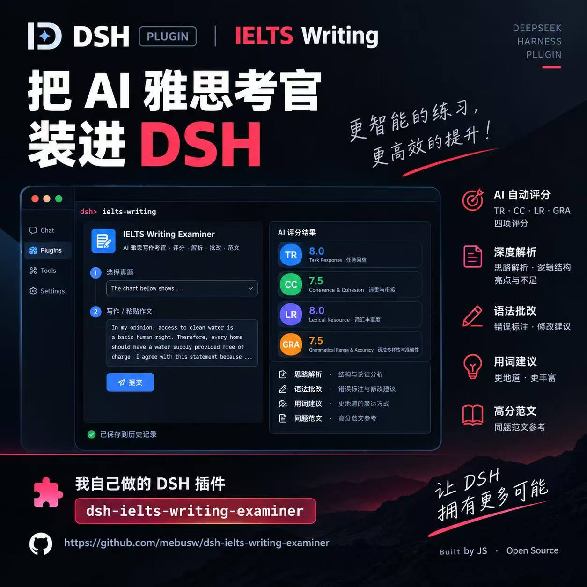

# dsh-ielts-writing-examiner（雅思写作练习与 AI 评分）

一个跑在 [DeepSeek Harness (DSH)](https://github.com/deepseek-ai) **web**
profile 里的 IELTS 写作练习 + AI 评分插件。

挑一道真题、写一篇作文、拿到完整的四项评分（TR / CC / LR / GRA），
外加思路解析、语法批改、用词建议和同题范文。每次练习都作为一条
session 保存到侧栏，可以回看、克隆或删除。

所有页面的**右侧工作区底部**都有一个常驻的 chatbox（不占左侧会话栏），
任何阶段都能直接问 AI 考官。在批改结果页用鼠标选中任意文字，底部
chatbox 会显示这段引用；引用文字会作为对话上下文发给模型，追问始终
锚定在你正在看的内容上。对话按练习（session）分别保存。

模型完全跟 DSH runtime 当前默认模型走，插件里没有渠道切换也没有
API key UI —— 模型配置在 host 那边改。




## 依赖

| 包 | 版本 | 作用域 |
| --- | --- | --- |
| `dsh-app-dock` | `^0.1.5` | npm 依赖 |
| `@deepseek-ai/cordis` | `^4.0.2` | peer 依赖 |

**`dsh-app-dock` 是无 scope 的**——没有 `@deepseek-ai/` 前缀，
`npm view @deepseek-ai/dsh-app-dock` 会返回 404。本插件的入口按钮就
住在它提供的左下角共享图标网格里。

光有依赖不够：dsh 只拼装 profile `dsh.profile.bundles` 里列出的 bundle
层，npm 依赖不会自动出现在那个列表里。所以坞要**单独装**：

```bash
npx @deepseek-ai/dsh plugin --profile web add dsh-app-dock
npx @deepseek-ai/dsh plugin --profile web add dsh-ielts-writing-examiner
```

装完确认两者都在：

```bash
npx @deepseek-ai/dsh --profile web --dump-config | grep -E '^\s*name:'
# 应当同时看到 '@deepseek-ai/dsh-app-dock' 和 'dsh-ielts-writing-examiner'
```

坞缺席也能用。client 半边会先尝试入坞，等一个 1.5 秒宽限期后若坞仍
未出现，就自持一个 footer 按钮兜底；坞迟到就让位并撤掉兜底入口——
始终只有一个入口。`~/.ielts-examiner/diag.jsonl` 里的
`{"phase":"entry","entry":"dock"}` 与 `{"phase":"entry","entry":"footer"}`
告诉你当前生效的是哪一种。

### 模型解析

批改**不假设任何特定厂商**。host 半边从 `agentDefaultModel` 服务读取
用户的选择，再通过 `llm` 服务发起调用——endpoint 和密钥的解析由它负责
（`@deepseek-ai/dsh-llm` 里根本没有 `baseUrl` 这个概念）。硬编码的
provider 表只作为「脱离 DSH 运行时」时的兜底保留。

代价是 profile 里必须有 `llm` 和对应的 `dsh-llm-*` 适配器包。把它
单独拆出去用，批改会退化到独立 HTTP 路径，而那条路只认 DeepSeek 形状
的 endpoint。

## 安装

插件通过 `dsh plugin add` 安装进某个 DSH profile，本质上是把
`pnpm add` 在 profile 目录下执行一遍。

GUI 入口在共享的**应用坞**里（`dsh-app-dock`，见[依赖](#依赖)），
所以先装坞，再装本插件：

```bash
npx @deepseek-ai/dsh plugin --profile web add dsh-app-dock
npx @deepseek-ai/dsh plugin --profile web add dsh-ielts-writing-examiner
```

把 `web` 换成目标 profile 名（如 `desktop`）。装好之后重启 `dsh web`
（或者靠 profile 配置里的 `patchReload: live` 热加载新 bundle）。dsh
左下角应用坞的图标网格里会出现 **IELTS 写作** 按钮，点开就是工作台。

注意：除了把包安装进去，profile 的 `dsh.profile.bundles` 里也要列
上这些包，host 半边才会被拼到 patch tree 上。下面的本地开发流程
会帮你一起搞定。

## 本地开发

```bash
# 1. 把 host + client 两半构建到 lib/
pnpm install
pnpm build

# 2. 接到本地 DSH web profile（写入 ~/.dsh/profiles/web）
pnpm reinstall    # = bash scripts/reinstall.sh

# 3. 离线 smoke（不调 LLM）
pnpm verify
```

`scripts/reinstall.sh` 会先跑 `pnpm build`，然后在
`~/.dsh/profiles/web` 里执行 `pnpm add file:<repo>`。脚本退出后，
刷新一下 web profile 即可。

浏览器侧的检查用 `pnpm test:ui`：它在独立无头 Chromium 里加载 client
bundle，mock 宿主 RPC 和 SSE 对话流，截图写到 `e2e/artifacts/`。需要
Playwright 的 Chromium；如果没有，用 `CHAT_UI_CHROMIUM` 指向一个
Chrome/Chromium 可执行文件即可。

## 适配的 DSH 版本

以 **Harness 0.2.x** 为适配目标（在 0.2.1-rc.2 上验证）：

- 宿主语言读 `ctx.get('locale')`（0.2.x 的 LocaleRuntime，带
  `subscribe`）；旧的 `ctx.get('lang')` 钩子保留为兜底。
- 应用坞按 0.2.x 的加载顺序仲裁：坞优先，缺席才自持 footer。
- 对话流会给历史 assistant 消息补
  `source: { kind: 'model', provider, model }`，这是 0.2.1 的 `llm`
  适配器（`dsh-llm-deepseek` / `dsh-llm-pi-ai`）要求的结构。

## 排障

入口按钮没出现时，插件会把裁决过程落到
`~/.ielts-examiner/diag.jsonl`（每行一条 JSON）：

```bash
tail -n 5 ~/.ielts-examiner/diag.jsonl
```

- `{"phase":"entry","entry":"dock"}` —— 已入坞；配 `entry-rendered`
  里的 `dom:false` 说明坞收了但没渲染。
- `{"phase":"entry","entry":"footer"}` —— 坞缺席，已自持 footer 兜底。
- 两条都没有 —— client 半边根本没装载（检查 profile 的
  `dsh.profile.bundles`）。

## 使用

1. 点应用坞里的 **IELTS 写作** 按钮（或兜底 footer 按钮），打开工作台。
2. 侧栏列出每一次练习，格式是 `题目类型 · 分数 · 时间`。鼠标悬
   停一行会露出 **↻**（同一题再来一次）和 **✕**（删除）。
3. 侧栏顶部 **+ 新练习** 打开选题页，从内置题库里挑一道 Task 1
   或 Task 2 的真题。
4. 在 textarea 里写你的作文；每停 1.5 秒自动保存。
5. 点 **提交评分** —— AI 考官会异步批改。视图先切到加载页，评分
   回来后自动切到完整的 Result 视图。
6. 侧栏底部的 **中 / EN** 切换按钮会实时把所有可见文案在中文和英
   文之间切换 —— 侧栏标题、底部计数、卡片标题、按钮文案、时间
   表达、错误提示全都跟着切；AI 评分本身的输出语言由模型决定
   （prompt 里两种语言都能用）。
7. 每个页面的**右侧工作区底部**都有 chatbox（左侧会话栏保持通高）。
   输入问题后按 **Enter** 发送（Shift+Enter 换行），回复会流式显示。
   对话按练习保存，重新打开该练习会自动恢复；每次 **+ 新练习** 都是
   独立的空对话，切换练习不会互相串内容；流式输出期间发送按钮会变成
   停止按钮。
8. 在批改结果页用鼠标选中任意文字，底部 chatbox 的「引用」区会出现
   对应的引用标签；提问时这段文字会作为上下文一起发给模型。点标签
   上的 × 可以移除；最多累积 3 条引用，发送后自动清空。chatbox 在
   所有页面都在，但主内容区的任意文字都可以被引用。

### 对话框机制

- host 端和评分一样走 DSH runtime 当前默认模型，通过 `llm` 服务
  流式返回（`POST /ielts-examiner/chat`，`text/event-stream`）；
  脱离 DSH 运行时会退化为 OpenAI 兼容的 HTTP 流。
- 每一轮都会把当前页面、题目、作文、批改摘要（都有长度上限）带给
  模型，所以回答始终基于正在讨论的这篇作文。
- 每次练习拥有自己的对话：切换侧栏 session 只会加载那次练习的对话。
  每次点 **+ 新练习** 都会生成独立的空对话 key（`draft-<id>`），未提交
  的练习之间不会共享聊天；点提交评分时这段对话会迁移到新建的 session。
  欢迎页使用单独的 `draft` 线程。
- 对话保存在 `~/.ielts-examiner/chats/<session-id>.json`（未提交的练习
  是 `draft-<id>.json`，欢迎页是 `draft.json`）。删除练习会一并删除
  对应对话；被放弃的未提交对话会在 7 天后清理。
- 回复失败时会保留提问并就地显示错误；已经流出的部分内容会留在对话
  里，直到刷新页面。

## 数据位置

```
~/.ielts-examiner/
├── index.json                     # SessionRecord[]（侧栏数据源）
├── sessions/<sid>/
│   ├── meta.json                  # { id, questionId, status, wordCount, … }
│   ├── essay.txt                  # 原始作文
│   └── result.json                # 完整 LLM 输出（JSON.parse 后的对象）
├── chats/<key>.json               # 对话记录：<sid>、未提交练习 draft-<id>、欢迎页 draft
└── prompts/
    └── 雅思写作.compressed.prompt.md   # 首次启动时从 bundle 拷过来
```

`~/.ielts-examiner` 在第一次启动时创建。session 用 12 位 id 作为
key；克隆一个 session 会复制它的 `questionId` 和作文，但会开一次
全新的评分。

## 模型

插件通过 `ctx.agentDefaultModel.currentSelection()` 读 DSH 的
`agent-default-model` 配置。在 `~/.dsh/settings.yaml` 里改：

```yaml
agent-default-model:
  provider: deepseek
  model: deepseek-chat
```

插件里故意没有 provider / key 的 UI。要切模型，改 host 配置然后
reload profile 即可。

## 功能

- **侧栏 session 列表**：状态点（idle / running / done / failed），
  显示最近操作时间。
- **作文自动保存**：每次停止输入 1.5 秒后写盘。
- **异步评分**：1.5 秒轮询；评分完成后自动跳到 Result。
- **四项评分**：Task Response / Coherence & Cohesion /
  Lexical Resource / Grammatical Range。
- **批注文本**：用 `<ins>`/`<del>` 高亮建议的修改。
- **思路 / 重点 / 技巧 / 结构（mermaid 图）**：分析卡。
- **语法批改 + 用词替代**：可折叠展示。
- **同题范文**：高分范文卡。
- **中 / EN UI 切换**：侧栏底部按钮，所有可见文案（侧栏标题、
  底部计数、卡片标题、按钮、时间、错误）都跟着切。
- **每个页面右侧工作区底部的 chatbox**（左侧会话栏保持通高）：
  流式回复、按练习保存对话、Enter 发送、可停止。
- **选中即引用**：主内容区的选中文字会变成 chatbox 里可删除的引用
  标签，并作为对话上下文发送。
- **克隆 / 删除**：侧栏行级操作；删除练习会一并删除对应对话。

## 脚本

| 脚本           | 作用                                                  |
| -------------- | ----------------------------------------------------- |
| `pnpm build`   | 把 host (esbuild) + client (concat) 打到 `lib/`。     |
| `pnpm verify`  | 构建后跑离线 smoke（RPC、asset、prompt、chat）。       |
| `pnpm reinstall` | 重新构建并安装进 `~/.dsh/profiles/web`。             |
| `pnpm test:ui` | 无头 chat UI 检查（独立 harness，不需要起服务）。      |
| `pnpm pack:dry` | 看 `npm pack` 会发布什么。                           |

## 文件结构

```
src/
├── host/                  # Node 端：注册 RPC、asset、prompt、调 LLM
│   ├── apply.js           # apply(ctx, {dataDir}) → 挂载路由（含 chat SSE）
│   ├── session-store.js   # 对 ~/.ielts-examiner/sessions/<id>/ 做 CRUD
│   ├── chat-store.js      # 按练习保存对话到 ~/.ielts-examiner/chats/
│   ├── chat-prompt.js     # chat 的 system prompt + provider 无关消息历史
│   ├── chat.js            # 一轮流式对话（走 runtime 默认模型）
│   ├── llm.js             # 调 DSH runtime 当前默认模型（评分 + 流式 delta）
│   ├── prompt.js          # 首次启动时把内置 prompt 拷到用户目录
│   ├── default-model.js   # 从 host 配置里读 provider/model
│   └── question-bank.js   # 读 assets/雅思真题.json
├── client/                # 浏览器端：React UI（function components）
│   ├── index.js           # 入口仲裁（应用坞优先 / footer 兜底）+ overlay 面板
│   ├── pages.js           # Root, Nav, NewPractice, Result, Loading, SessionDetail
│   ├── chat.js            # 底部 chatbox + 引用标签 + SSE / 上下文 helper
│   ├── components.js      # iwCard / iwBtn / iwBadge / …
│   ├── strings.js         # 中英 i18n 表；`t(lang)` 查表
│   ├── styles.js          # scoped CSS 模板字符串
│   ├── api.js             # /ielts-examiner/rpc RPC + chat SSE 客户端
│   ├── md.js              # markdown + mermaid 渲染
│   └── export-pdf.js      # （当前关闭）html2pdf 导出
└── shared/
    └── schema.js          # host 和 client 共用的 result schema

assets/
├── 雅思真题.json          # 题库
└── images-for-task1/      # Task 1 题目里引用的图片

prompts/
└── 雅思写作.compressed.prompt.md   # 考官 prompt，首次启动拷到 ~/.ielts-examiner/prompts/

cordis.patch.yml           # bundle layer 清单（id: dsh-ielts-examiner）
lib/                       # 构建产物（gitignored）
  ├── index.js             # host 半边
  └── client.js            # client 半边（浏览器，ModuleLoader 包装）
```

## License

MIT.
